# Architecture

```
 Browser / PWA (React SPA)  ──HTTPS──►  nginx (web)  ──/api, /socket.io──►  API (Express 5)  ──►  PostgreSQL
        ▲   Web Push (sw.js)                                    │  ▲                              ▲
        │                                                       │  │ Redis pub/sub (realtime)     │
        └────────────── Socket.IO (live notifications) ◄────────┘  │                              │
                                                                   ▼                              │
                                                  Redis (BullMQ queues, AOF)  ◄──►  Worker process ┘
                                                                                    ├─ schedules: fire reminders at exact time
                                                                                    ├─ deliveries: per-channel delivery + retries
                                                                                    └─ maintenance: sweep · escalations · recurring tasks · daily-report nudges
```

* **API** is stateless (JWT), horizontally scalable. Every request: authenticate → permission guard (`requirePerm`) →
  row-level **scope** filter (`auth/scope.ts`) → Zod validation → parameterized SQL (Knex) → audit log.
* **Worker** runs BullMQ consumers. Any number of workers can run; BullMQ hands each job to one worker, and
  PostgreSQL row locks + unique `dedupe_key`s make firing idempotent.
* **PostgreSQL is the source of truth** for schedules (`notification_schedules.next_run_at`). Redis holds the
  delayed jobs for precise timing; if Redis data is lost the one-minute *sweeper* re-fires anything overdue and
  re-arms upcoming jobs.
* **Realtime**: workers publish to a Redis channel; every API instance relays to its Socket.IO rooms (`u:<userId>`).

## Multi-tenancy

Every organization (tenant) is a row in `organizations`; every business table carries `organization_id`.
Isolation is enforced **in PostgreSQL** with row-level security, not only in application code:

* Each tenant table has `ENABLE` + `FORCE ROW LEVEL SECURITY` and a policy
  `organization_id = app_current_org()`, where `app_current_org()` reads the transaction setting `app.org_id`.
  `organization_id` defaults to the same value, so inserts are stamped automatically.
* `authenticate` opens one transaction per request and runs `set_config('app.org_id', <user's org>, true)`.
  The exported `db` is a proxy that routes every query to that transaction (via `AsyncLocalStorage`), so a query that
  forgets a tenant filter still cannot read or write another organization's rows. The transaction commits right before
  the response is sent (status < 400) and rolls back otherwise; queue jobs are enqueued only after commit.
* Background jobs resolve the organization of the row they process (schedule, delivery log) or iterate active
  organizations, and run inside `runInOrg(orgId, …)` with the same guarantees.
* With no `app.org_id` set (sign-in, registration, job dispatch) the policy is permissive; those paths filter explicitly.
* Per-tenant: role → permission matrix, settings, notification and escalation rules, department/project/skill codes,
  employee codes. Global: roles, permissions, and user emails (an email identifies the tenant at sign-in).
* **The application must connect as a non-superuser role** (superusers bypass RLS). Docker creates one
  (`docker/postgres-init`); locally use `orgpm_app`; Render's database user already qualifies.
* Self-service onboarding: `POST /api/auth/register` creates the organization, seeds its defaults and its first Super Admin.

## Daily questionnaire & EOD

Questions (`questions`, `question_assignments`, sections, editable templates) are configuration; a worker job materialises
them into per-employee `checklists`/`checklist_items` (unique per user × local date × question, question text snapshotted).
Submitted answers are versioned in append-only `checklist_answer_revisions`. Reminders and escalations reuse the
notification pipeline; EOD reports are JSON snapshots in `eod_reports`, filtered per viewer. Details: [CHECKLISTS.md](CHECKLISTS.md).

## Roles, permissions & data scope

Two independent layers:

1. **Permissions** (what you may do): 44 keys in `server/src/auth/permissions.ts`, assigned per role **per organization** in
   `role_permissions` and editable at runtime (Settings → Roles & permissions; Super Admin always has all).
2. **Scope** (which rows you may see), fixed per role: `organization` (Super Admin, Director, Management Viewer),
   `project` (Project Manager: projects they manage/belong to), `department` (HOD), `team` (Team Leader), `self` (Employee).
   Out-of-scope records return **404** (existence is not leaked). Direct reports are always visible to their manager.

Extra guards: no self-approval of tasks or approval requests, HOD/TL can only assign inside their department/team,
users cannot grant roles at/above their own rank, budget changes on approved projects require an approval request,
milestone completion and resource allocation by non-approvers create approval requests.

## Task workflow

```
not_started → in_progress ⇄ on_hold / blocked → submitted → under_review → completed (approval only)
                    ▲                                   │
                    └────────── revision_required ◄─────┘ (reviewer: revision / reject, comment required)
any open state → cancelled (manager, reason required)      completed/cancelled → reopen (manager)
```
Progress is capped at 99% until approval; completion sets `completed_at`, `approved_by`, quality rating, recomputes
project progress (effort-weighted) and applies the reminder-on-close policy.

## Data model (ERD)

Full DDL with constraints and indexes: [`server/migrations/001_init.sql`](../server/migrations/001_init.sql).

```mermaid
erDiagram
  organizations ||--o{ users : "tenant (every business table has organization_id)"
  roles ||--o{ role_permissions : grants
  permissions ||--o{ role_permissions : ""
  roles ||--o{ users : has
  departments ||--o{ users : employs
  departments ||--o| users : "hod_id"
  departments ||--o{ teams : contains
  teams ||--o{ users : members
  teams }o--|| users : "leader_id"
  designations ||--o{ users : ""
  users ||--o{ users : "manager_id"
  users ||--o{ reporting_hierarchy : history
  users ||--o{ user_skills : ""
  skills ||--o{ user_skills : ""
  users ||--o{ refresh_tokens : sessions

  projects ||--o| future_projects : "planning data"
  projects ||--o{ project_members : ""
  projects ||--o{ project_milestones : ""
  projects ||--o{ project_deliverables : ""
  projects ||--o{ project_risks : ""
  projects ||--o{ project_dependencies : ""
  projects ||--o{ project_resources : ""
  projects ||--o{ project_documents : ""
  projects ||--o{ project_discussions : ""
  projects ||--o{ approval_requests : ""

  projects ||--o{ tasks : ""
  project_milestones ||--o{ tasks : ""
  departments ||--o{ tasks : ""
  tasks ||--o{ task_assignees : ""
  users ||--o{ task_assignees : ""
  tasks ||--o{ subtasks : ""
  tasks ||--o{ task_checklist_items : ""
  tasks ||--o{ task_updates : "progress log"
  tasks ||--o{ task_comments : ""
  tasks ||--o{ task_attachments : ""
  files ||--o{ task_attachments : ""
  files ||--o{ project_documents : ""
  tasks ||--o{ task_dependencies : ""
  tasks ||--o{ task_approvals : "completion / extension"
  tasks ||--o{ time_entries : ""
  tasks ||--o{ tasks : "recurrence_parent_id"
  recurring_schedules ||--o{ tasks : "recurring template"

  users ||--o{ daily_reports : ""

  notification_schedules ||--o{ notification_recipients : ""
  notification_schedules }o--o| recurring_schedules : ""
  notification_schedules }o--o| tasks : ""
  notification_schedules }o--o| management_agenda : ""
  notification_schedules ||--o{ notification_logs : ""
  notification_rules ||--o{ notification_logs : ""
  escalation_rules ||--o{ escalation_history : ""
  tasks ||--o{ escalation_history : ""
  escalation_history ||--o{ notification_logs : ""
  users ||--o| user_notification_preferences : ""
  users ||--o{ push_subscriptions : ""
  users ||--o{ device_tokens : ""
  users ||--o{ management_agenda : ""

  meetings ||--o{ meeting_attendees : ""
  meetings ||--o{ meeting_action_items : ""
  meeting_action_items }o--o| tasks : "converted"
  users ||--o{ audit_logs : actor
```



### Table notes
| Table | Purpose / notable constraints |
|---|---|
| `users` | soft delete (`deleted_at`), employment status, capacity h/week, lockout counters; unique `email`/`employee_code` (citext) |
| `reporting_hierarchy` | full history of manager changes (`effective_from/to`, `changed_by`); `users.manager_id` is current |
| `projects` + `future_projects` | future planning data in its own table with 8 readiness booleans and a **generated** `readiness_percent`; kept after conversion (`converted_at`) |
| `tasks` | `task_key` from a sequence (`TSK-1000…`), status CHECK, progress 0–100, complexity 1–5, `is_overdue` flag maintained by the worker, recurring template/instance columns with a unique (parent, deadline) index |
| `task_approvals` | completion reviews and extension requests; partial unique index → one pending request per type per task |
| `approval_requests` | project approval, milestone, resource allocation, scope and budget changes with JSON payload applied on approval |
| `notification_schedules` | one_time / recurring / deadline_offset; CHECK constraints per type; `next_run_at` indexed for active rows |
| `notification_logs` | one row per occurrence × recipient × channel; unique `dedupe_key`; statuses scheduled/sent/delivered/failed/retried/read/cancelled/skipped; doubles as the in-app inbox |
| `escalation_history` | unique (task, rule, deadline_snapshot) → each level fires once per deadline |
| `audit_logs` | append-only, enforced by a trigger that rejects UPDATE/DELETE |

## Frontend structure

`web/src/components` — design system (`ui.tsx`: cards, stats, badges, responsive `DataTable` that renders cards on phones,
bottom-sheet `Modal`, chips, people picker, tabs, pagination, confirm dialog), `AppShell` (desktop sidebar, tablet
icon rail, phone top bar + bottom navigation + drawer), `charts.tsx` (Recharts with a validated colour palette),
`Gantt.tsx`. Pages are lazy-loaded per route. Server state via TanStack Query; live refresh on Socket.IO events.
